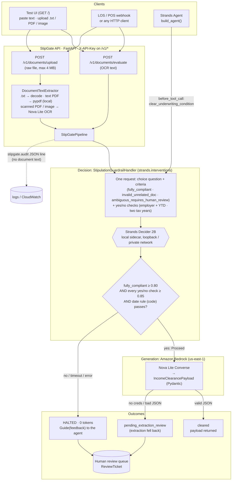
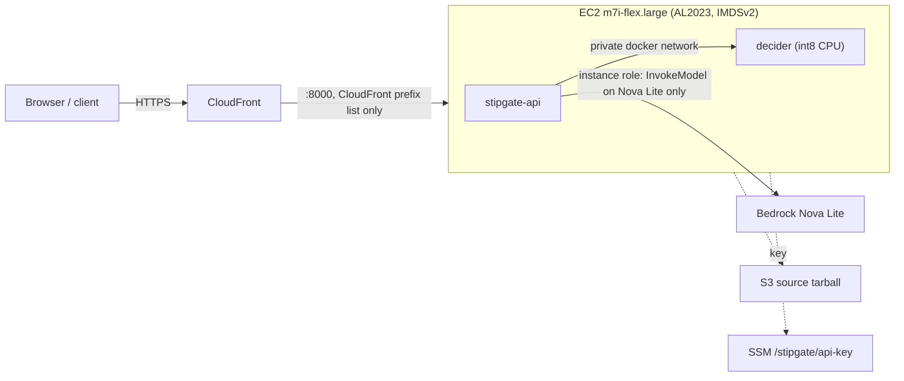

# StipGate

**A Strands Decider 2B guardrail that checks a borrower's mortgage document before any LLM token is spent on it.**

[](https://github.com/gouthamb-dev/stipgate/actions/workflows/ci.yml)


`#strands-decider-2b` `#guardrails` · Built for the AWS Builder Center *Agent Experience Hackathon: Strands Decider*

**▶ Demo video (under 3 min): [StipGate guardrails stop bad mortgage documents](https://www.loom.com/share/2c705d498d9344fa9f2ff61960cf49e3)**

A Strands agent wants to call `clear_underwriting_condition` on an uploaded document. Before the tool runs,
a Strands `InterventionHandler` makes **one Decider 2B call** that answers two kinds of typed question:
*is this the document the condition requires?* (a `choice`) and *is the required content there?* (yes/no
`noul` checks). Plain code then checks the dates. Only a document that passes all three reaches Amazon
Bedrock Nova Lite for extraction. Everything else is halted with **zero LLM tokens** and sent to a human
loan officer. Every error fails closed.

| | |
|---|---|
| **Decision pattern** | Guardrails: verify a tool call's arguments (the document) before the tool runs |
| **Decider 2B questions** | one `choice` (3 typed options, a definition per option) + per-condition yes/no checks, in one request |
| **Bedrock** | Nova Lite (`amazon.nova-lite-v1:0`) for extraction, and for OCR of scanned PDFs / images |
| **Reusable asset** | `StipulationGuardrailHandler` + `build_question` / `build_criteria` / `build_requirement_checks` ([recipe below](#the-reusable-decision-pattern)) |
| **Runs on** | laptop (heuristic demo or local Decider), Docker Compose, or AWS (EC2 + CloudFront scripts included) |

---

## Results: 100 held-out documents on the live deployment

Real Decider 2B (int8, CPU) and real Nova Lite, 2026-10-22. The LLM-only baseline gives Nova Lite the
**same** question, options, requirement checks and date rule in words. Raw per-document results and the
method: [benchmarks/](benchmarks/README.md).

| Judge | Accuracy | Hallucinated approvals | False halts | Decision tokens | Decision p50 |
|---|---|---|---|---|---|
| **StipGate** (Decider 2B + date rule) | **100%** | **0 / 55** | **0 / 45** | **0** | 4.7 s (CPU) |
| Nova Lite with the full rubric | 69% | 31 / 55 | 0 / 45 | 45,922 | 0.35 s |
| StipGate v1 (type question only) | 69% | 21 / 55 | 10 / 45 | 0 | 2.7 s (CPU) |

Nova Lite approved **every** stale paystub (12/12), **every** paystub missing the employer and YTD (8/8) and
11 of 12 garbled scans, even though it was told the rules and today's date. StipGate caught all of them.

The four core samples through the public endpoint:

| Document | Decider 2B verdict | Confidence | Requirement check | Gate | Nova Lite |
|---|---|---|---|---|---|
| SG-001 valid 30-day paystub | `fully_compliant` | 0.967 | employer + YTD 0.95 | PROCEED, **cleared** | 450 tokens, 0.44 s |
| SG-002 utility bill sent as income proof | `invalid_unrelated_doc` | 0.946 | employer + YTD 0.11 | HALTED | **0 tokens** |
| SG-003 two years of W-2s | `fully_compliant` | 0.940 | two tax years 0.96 | PROCEED, **cleared** | 639 tokens, 0.52 s |
| SG-004 truncated / corrupted OCR scan | `ambiguous_requires_human_review` | 0.237 | employer + YTD 0.38 | HALTED | **0 tokens** |

On this 2-vCPU instance the gate takes 4-8 s per document. Upstream publishes ~115 ms median per question on
an RTX 3090 ([inference.md](https://github.com/strands-labs/strands-decider/blob/main/docs/inference.md)), so
a GPU host is the way to a real-time gate. Here the win is correctness, zero decision tokens, and no document
text leaving the host before the gate.

---

## Architecture



AWS deployment used by the live demo (scripts in [`deploy/aws/`](deploy/aws/README.md)):



Sequence diagram, trust boundaries, PII flow and the fail-closed matrix: [docs/ARCHITECTURE.md](docs/ARCHITECTURE.md).

---

## The reusable decision pattern

The asset other builders can drop into their own agent: **a typed question with a definition per option,
yes/no requirement checks asked in the same call, a code rule for anything numeric, and the wiring that puts
it in front of a tool.**

```
tool call ─► Decider 2B (one request) ─────────────► code rule ──────────► tool runs
             choice: what is this document?          date within window?
             noul:   is the required content there?
             any "no", low confidence, error ─► HALT + human review, 0 tokens
```

### 1. The question and options

```python
# stipgate/handlers.py
VERDICT_OPTIONS = ("fully_compliant", "invalid_unrelated_doc", "ambiguous_requires_human_review")

CONDITION_DOCUMENTS = {
    "STIP_INCOME_30DAY": "a paystub (earnings statement) from the borrower's employer",
    "STIP_W2_2YR": "IRS Form W-2 wage statements for the borrower covering two tax years",
    "STIP_ASSET_2MO": "two monthly bank statements for the borrower",
}

QUESTION_TEMPLATE = (
    "Stipulation {condition_code}: classify this document for the mortgage condition that requires {document}."
)

def build_criteria(condition_code: str) -> dict[str, str]:
    document = required_document(condition_code)
    return {
        "fully_compliant": f"It is {document} and is readable and complete.",
        "invalid_unrelated_doc": f"It is not {document}; it is another kind of document.",
        "ambiguous_requires_human_review": "It is garbled, cut off or unreadable.",
    }
```

What goes over the wire (official `strands-decider serve` contract, `POST /v1/systemone` or `/invocations`):

```json
{"state": "<document text>",
 "questions": {"stipulation_verdict": {
   "type": "choice",
   "instructions": "Stipulation STIP_INCOME_30DAY: classify this document for the mortgage condition that requires a paystub (earnings statement) from the borrower's employer.",
   "criteria": {
     "fully_compliant": "It is a paystub (earnings statement) from the borrower's employer and is readable and complete.",
     "invalid_unrelated_doc": "It is not a paystub (earnings statement) from the borrower's employer; it is another kind of document.",
     "ambiguous_requires_human_review": "It is garbled, cut off or unreadable."}}}}
```

### 2. Yes/no requirement checks in the same request, and a code rule for dates

```python
# stipgate/handlers.py (abridged)
def build_requirement_checks(condition_code, as_of):
    if condition_code == "STIP_INCOME_30DAY":
        return {"has_employer_and_ytd": YesNoCheck(
            question="Does this paystub show the employer's name and the year-to-date (YTD) gross earnings?",
            true_means="both the employer name and a YTD gross amount are present",
            false_means="the employer name or the YTD gross amount is missing")}
    if condition_code == "STIP_W2_2YR":
        return {"covers_two_tax_years": YesNoCheck(
            question=f"Does this document include W-2 forms for both tax year {as_of.year - 1} and tax year {as_of.year - 2}?",
            true_means=f"there is a W-2 for {as_of.year - 1} and a separate W-2 for {as_of.year - 2}",
            false_means="only one tax year is present, or a year is missing")}
    return {}

RECENCY_WINDOW_DAYS = {"STIP_INCOME_30DAY": 30, "STIP_ASSET_2MO": 60}   # checked in code, not by the model
```

Each check is sent as a `noul` question next to the `choice` question, so it costs one Decider call:

```json
"has_employer_and_ytd": {"type": "noul",
  "instructions": "Does this paystub show the employer's name and the year-to-date (YTD) gross earnings?",
  "criteria": {"true": "both the employer name and a YTD gross amount are present",
               "false": "the employer name or the YTD gross amount is missing"}}
```

Decision rule: `fully_compliant` with confidence ≥ **0.80**, every check P(yes) ≥ **0.85**, and the date rule
passes. A missing or malformed check answer fails closed. Thresholds were tuned on a separate seed
([benchmarks/](benchmarks/README.md#how-the-thresholds-were-chosen)).

> **Lessons learned on the live model.**
> 1. **Define every option.** v1 sent bare option names (`"criteria": {"fully_compliant": null, ...}`). Every
>    sample came back `invalid_unrelated_doc`, valid paystubs included. One-sentence definitions fixed all four
>    verdicts and lifted valid documents from 0.33-0.59 to 0.91-0.94 confidence.
> 2. **One question can't carry every rule.** With only the document-type question, the gate approved every
>    stale paystub and every paystub missing fields (38% hallucinated approvals on 100 held-out documents).
>    Adding yes/no checks for the missing content brought that to 0%.
> 3. **Don't ask the model to do arithmetic.** Asked "did the pay period end within the last 30 days?",
>    Decider 2B gave 10-day-old and 90-day-old paystubs the same scores (0.63-0.80 vs 0.51-0.73). A few lines
>    of code now check the date. Decider judges meaning; code checks numbers.

### 3. The wiring: a Strands intervention in front of the tool

```python
from strands import Agent
from strands.models.bedrock import BedrockModel
from stipgate import (BedrockExtractor, DeciderClient, InMemoryReviewQueue,
                      StipulationGuardrailHandler, make_clearance_tool)

decider = DeciderClient("http://127.0.0.1:8099/v1/systemone", timeout_s=1.5, mode="server")
queue = InMemoryReviewQueue()            # or anything with enqueue(ticket) -> None: SQS, an LOS task API
handler = StipulationGuardrailHandler(
    decider,
    confidence_threshold=0.80,           # document-type choice must be fully_compliant at >= 0.80
    check_threshold=0.85,                # every yes/no requirement check must reach P(yes) >= 0.85
    review_queue=queue,
    target_tool="clear_underwriting_condition",
)

agent = Agent(
    model=BedrockModel(model_id="amazon.nova-lite-v1:0", region_name="us-east-1"),
    tools=[make_clearance_tool(BedrockExtractor(), queue)],
    interventions=[handler],             # before_tool_call -> Proceed() or Guide(feedback)
    callback_handler=None,
)
agent("Borrower uploaded doc DOC-77 for STIP_INCOME_30DAY: <ocr text>")
```

On a halt the handler returns `Guide(feedback=...)`; Strands cancels the tool, the model receives the
guidance as the tool result, and a `ReviewTicket` is queued. `build_agent(StipGatePipeline())` does the same
wiring. Without an agent loop: `StipGatePipeline(decider=decider).process_document(doc_id, text, code)`.

> The spec this was built from referenced `strands.handlers.InterventionHandler`. That path does not exist in
> strands-agents 1.61.1; the real API is `strands.interventions`, which StipGate subclasses directly.

### 4. Adapting it to your own agent

Swap the domain, keep the shape:

```python
from stipgate import DeciderClient
from stipgate.decider_client import YesNoCheck

result = DeciderClient("http://127.0.0.1:8099/v1/systemone").decide_detailed(
    text=user_supplied_document,
    question="Classify this document for the expense claim that requires an itemised hotel receipt.",
    options=["valid", "wrong_document", "needs_human_review"],
    criteria={
        "valid": "It is an itemised hotel receipt and is readable and complete.",
        "wrong_document": "It is not an itemised hotel receipt; it is another kind of document.",
        "needs_human_review": "It is garbled, cut off or unreadable.",
    },
    checks={"shows_total_and_dates": YesNoCheck(
        question="Does the receipt show the total amount and the check-in and check-out dates?",
        true_means="the total and both dates are present",
        false_means="the total or a date is missing")},
)
ok = (result.verdict == "valid" and result.confidence >= 0.80
      and all(p >= 0.85 for p in (result.checks or {}).values()))
if ok and stay_dates_within_policy(user_supplied_document):   # numbers and dates: your code
    ...  # call the expensive tool / LLM
else:
    ...  # halt, ask the user, or route to a person
```

Rules that made it work: name the required thing in the question, define every option in one sentence,
include an explicit "send to a human" option, turn each content rule into its own yes/no check, keep date and
number arithmetic in code, tune thresholds on data you don't evaluate on, and treat every error as a halt.

---

## Quick start

Python 3.11+.

```bash
git clone https://github.com/gouthamb-dev/stipgate.git
cd stipgate
python -m venv .venv && source .venv/bin/activate      # Windows: .\.venv\Scripts\Activate.ps1
pip install -r requirements.txt
pip install -e ".[dev]"
python -m pytest -q                                      # offline, no AWS or model needed
```

**1. Offline demo (no model, no AWS).** Verdicts come from a built-in heuristic and the UI shows a yellow
"simulated" banner.

```bash
STIPGATE_DECIDER_MODE=heuristic STIPGATE_ALLOW_HEURISTIC_PROCEED=1 STIPGATE_BEDROCK_OFFLINE=1 stipgate-serve
# PowerShell: $env:STIPGATE_DECIDER_MODE="heuristic"; $env:STIPGATE_ALLOW_HEURISTIC_PROCEED="1"; $env:STIPGATE_BEDROCK_OFFLINE="1"; stipgate-serve
```

Open http://127.0.0.1:8000/, load a sample, click **Evaluate document**.

**2. Real Decider 2B + Nova Lite.** Serve the model (GPU strongly recommended; see
[docs/DECIDER_HOSTING.md](docs/DECIDER_HOSTING.md)), have AWS credentials with Nova Lite access in us-east-1,
then:

```bash
pip install strands-decider
strands-decider serve StrandsAgents/strands-decider-2B-qwen3.5-v1-2610 --port 8099 --device cuda   # or mps | mlx | cpu
export STIPGATE_DECIDER_URL=http://127.0.0.1:8099/v1/systemone
stipgate-serve
```

**3. Docker Compose.**

```bash
docker compose up --build decider stipgate-api            # API + CPU Decider sidecar on http://127.0.0.1:8000/
docker compose --profile demo up --build stipgate-demo    # heuristic demo on http://127.0.0.1:8001/
```

**4. AWS.** One EC2 instance behind CloudFront, deployed and updated with PowerShell + AWS CLI:

```powershell
pwsh deploy/aws/deploy.ps1          # S3, SSM API key, IAM role, security group, EC2 + bootstrap
pwsh deploy/aws/cloudfront.ps1      # HTTPS URL, locks the instance to CloudFront
pwsh deploy/aws/smoke-test.ps1 -BaseUrl https://<id>.cloudfront.net
pwsh deploy/aws/update-api.ps1      # ship code changes later
pwsh deploy/aws/teardown.ps1        # delete everything
```

Full guide, IAM, costs and security notes: [deploy/aws/README.md](deploy/aws/README.md). A production
design (ECS on EC2 GPU sidecar, internal ALB, PrivateLink, Secrets Manager): [docs/DEPLOYMENT.md](docs/DEPLOYMENT.md).

---

## API

| Method + path | Auth | Purpose |
|---|---|---|
| `GET /` | open | Self-contained test UI (no external assets, strict CSP) |
| `GET /healthz` | open | Liveness + Decider reachability, mode, Bedrock config, warnings |
| `POST /v1/documents/evaluate` | key | Gate OCR text. Body `{document_id, condition_code, snippet}` |
| `POST /v1/documents/upload?document_id=&condition_code=` | key | Raw file body (PDF, PNG, JPEG, GIF, WebP, UTF-8 text; max 4 MB). Extracts text, then gates it |
| `GET /v1/review-queue` | key | Tickets for loan officers |
| `GET /v1/samples` | key | The four benchmark documents |
| `GET /v1/metrics` | key | Counters, OCR tokens, gate latency p50 / p95 |

```bash
curl -s -X POST https://<host>/v1/documents/evaluate \
  -H "Content-Type: application/json" -H "X-API-Key: $STIPGATE_API_KEY" \
  -d '{"document_id":"DOC-77","condition_code":"STIP_INCOME_30DAY","snippet":"EARNINGS STATEMENT\nEmployer: ..."}'

curl -s -X POST "https://<host>/v1/documents/upload?document_id=DOC-78&condition_code=STIP_W2_2YR" \
  -H "X-API-Key: $STIPGATE_API_KEY" -H "Content-Type: application/pdf" --data-binary @w2s.pdf
```

Key fields in the response: `gated_action` (`PROCEED` / `HALTED`), `verdict`, `confidence`,
`clearance_status` (`cleared` / `pending_extraction_review` / `halted`), `tokens_spent`, `extracted_payload`,
`review_ticket_id`. Uploads add `ocr` (method, pages, tokens) and `extracted_text`.

How uploads are read: `.txt` is decoded and a PDF with a text layer is read with `pypdf`, both locally with 0
tokens. A scanned PDF or an image is transcribed by Nova Lite **before** the gate, so it spends OCR tokens even
when the document is then halted (reported separately as `ocr.total_tokens` / `ocr_tokens_spent`).

Every environment variable, PowerShell examples and response details: [docs/USAGE.md](docs/USAGE.md).

---

## Fail closed

The gate halts whenever anything is uncertain. Each row below is covered by a test
([full matrix](docs/ARCHITECTURE.md#fail-closed-matrix)).

- Decider unreachable, timeout, HTTP 4xx/5xx, non-JSON, a verdict outside the options, or a confidence that is
  not a number in [0, 1] → HALTED, verdict `decider_error`, 0 tokens, review ticket.
- `fully_compliant` below 0.80, or any other verdict → HALTED.
- A requirement check below 0.85 → HALTED (`failed_requirement_check`); a check the server did not answer
  → HALTED (`decider_error`).
- Paystub or statement older than its window, future-dated, or with no date found → HALTED (`failed_date_rule`).
- The heuristic simulator runs only on explicit opt-in and can never clear a condition unless
  `STIPGATE_ALLOW_HEURISTIC_PROCEED=1` (CI / demo only).
- Bedrock failure after the gate passed → `pending_extraction_review`, never `cleared`; synthetic fields are listed.
- For W-2s, `ytd_gross` is forced to equal the latest year's `gross_pay` if the model sums several years.
- `on_error="deny"`: a defect outside the handler still blocks the tool.

---

## Benchmark

```bash
python benchmark.py --offline --heuristic                  # 4 documents, expects PROCEED/HALTED/PROCEED/HALTED
python benchmark.py --decider-mode server                  # against a live Decider (+ Nova Lite with AWS creds)
python benchmark.py --heldout --decider-mode server        # seeded 100-document synthetic held-out set
python benchmark.py --heldout --llm-judge                  # LLM-only baseline: Nova Lite answers the same rubric
```

The held-out set (seed `20261019`) has 45 compliant documents (paystubs, two-year W-2s) and 55 non-compliant
ones (stale paystubs, single-year W-2s, utility bills, bank statements under an income code, corrupted scans,
missing fields). It reports cost reduction, hallucinated approvals, false halts, accuracy and gate p50 / p95.

Live results, per-category tables, how thresholds were tuned on a separate seed, the raw per-document files
and the caveats: [benchmarks/README.md](benchmarks/README.md). The set is synthetic and generated by this
repo; real borrower documents are messier.

Offline (no model), the built-in heuristic simulator scores 100% on the same set. It was written alongside the
set, so that number is a CI check, not a Decider 2B result. Pricing constants for cost estimates are named in
`benchmark.py`; verify them against current Bedrock pricing.

---

## Project layout

```
stipgate/
├── stipgate/
│   ├── handlers.py          # StipulationGuardrailHandler, question/criteria/check builders, date rule, queue
│   ├── decider_client.py    # DeciderClient (server | heuristic | auto), wire contracts, HeuristicDecider
│   ├── bedrock_worker.py    # BedrockExtractor (Nova Lite Converse) + IncomeClearancePayload
│   ├── ocr.py               # DocumentTextExtractor: .txt / pypdf / Nova Lite OCR for uploads
│   ├── pipeline.py          # StipGatePipeline, make_clearance_tool, build_agent
│   ├── api.py               # FastAPI service, auth, metrics, audit log, stipgate-serve
│   ├── samples.py           # synthetic benchmark / UI documents
│   └── static/index.html    # accessible single-file test UI
├── tests/                   # 125 offline tests (pytest), strict mypy
├── benchmark.py             # 4-document run, 100-document held-out set, --llm-judge baseline
├── benchmarks/              # live results (per-document JSON), tuning scores, method and caveats
├── deploy/aws/              # deploy, CloudFront, update, rotate key, smoke test, teardown
├── docker/decider/          # CPU Decider sidecar image (PyPI strands-decider)
├── docs/                    # ARCHITECTURE, DECIDER_HOSTING, DEPLOYMENT, USAGE
├── Dockerfile               # API image (non-root, healthcheck)
├── docker-compose.yml
└── .github/workflows/ci.yml # tests + mypy + benchmark + image build
```

## Docs

| Doc | Covers |
|---|---|
| [docs/ARCHITECTURE.md](docs/ARCHITECTURE.md) | Components, request sequence, trust boundaries, PII flow, fail-closed matrix, observability |
| [docs/DECIDER_HOSTING.md](docs/DECIDER_HOSTING.md) | Running Decider 2B: hosting options, serve flags, contract checks, latency tuning |
| [deploy/aws/README.md](deploy/aws/README.md) | The AWS deployment this demo runs on, step by step |
| [docs/DEPLOYMENT.md](docs/DEPLOYMENT.md) | Production reference design on AWS (guide only) |
| [docs/USAGE.md](docs/USAGE.md) | Every env var, API examples, uploads, embedding the handler |

## Security

- Set `STIPGATE_API_KEY` before exposing the API beyond loopback. Without it `/v1/*` is unauthenticated and
  responses carry borrower data. The key is shared, not per user.
- The Decider server has no authentication. Keep it on loopback or a private network.
- Audit log lines carry no document text and no extracted payload. Review tickets hold a 240-character preview.
- All sample documents and names in this repo are synthetic.
- Decider 2B is an experimental model. StipGate is a hackathon project and not a production underwriting system.

## License

[MIT](LICENSE)
