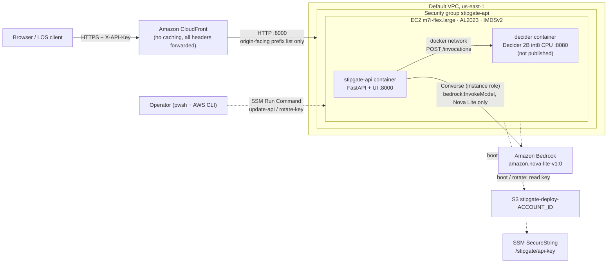

# Deploy StipGate to AWS (one EC2 instance + CloudFront)

The scripts in this folder are the deployment the live demo actually runs on. They need PowerShell 7
(`pwsh`, Windows / macOS / Linux) and the AWS CLI v2 with credentials for the target account.



## Scripts

| Script | What it does | Reversible |
|---|---|---|
| `deploy.ps1` | Creates the S3 bucket and uploads a source tarball, the SSM SecureString API key (32 random bytes), the IAM role and instance profile, a security group that allows port 8000 from your current public IP only, and the EC2 instance. `user-data.sh` builds both images and starts the containers on first boot. Idempotent: an existing instance is reused, **not** rebuilt. | `teardown.ps1` |
| `cloudfront.ps1` | Adds an HTTPS CloudFront distribution in front of the instance, opens 8000 to CloudFront's origin-facing prefix list, and revokes the direct `/32` rule. Prints the public URL. | Delete the distribution (comment `stipgate`) by hand |
| `update-api.ps1` | Ships local code changes: uploads a fresh tarball, then via SSM Run Command rebuilds **only** the `stipgate-api` image and recreates that container with its current settings. The Decider and its model cache are untouched. ~1-3 min API downtime. | Re-run with the previous code |
| `rotate-key.ps1` | Writes a new API key to SSM, recreates the API container with it, and scrubs the old key from the boot logs. | n/a (old key is invalid afterwards) |
| `smoke-test.ps1 -BaseUrl https://<id>.cloudfront.net` | Health, 401 check, the four samples (expects PROCEED/HALTED/PROCEED/HALTED), one plain-text upload, metrics. Exits non-zero on a mismatch. | read-only (adds review tickets) |
| `teardown.ps1` | Terminates the instance and deletes the security group, IAM role/profile, SSM key and S3 bucket. CloudFront is not deleted. | **No** |

## First deploy

```powershell
aws sts get-caller-identity                 # confirm the account
pwsh deploy/aws/deploy.ps1                  # ~2 min; prints the instance id and http://<ip>:8000/
# Bootstrap then takes ~10-20 min (image builds + ~4.6 GB model download + int8 quantisation).
pwsh deploy/aws/cloudfront.ps1              # prints https://<id>.cloudfront.net/ (~5 min to deploy)
pwsh deploy/aws/smoke-test.ps1 -BaseUrl https://<id>.cloudfront.net
```

Get the API key for the UI or for clients:

```powershell
aws ssm get-parameter --name /stipgate/api-key --with-decryption --query Parameter.Value --output text
```

Before the first deploy, confirm Amazon Nova Lite (`amazon.nova-lite-v1:0`) is available to the account in
us-east-1 in the Bedrock console. Without it every gated document becomes `pending_extraction_review`.

## Shipping changes

```powershell
python -m pytest -q; python -m mypy          # local checks first
pwsh deploy/aws/update-api.ps1
pwsh deploy/aws/smoke-test.ps1 -BaseUrl https://<id>.cloudfront.net
```

## What runs on the instance

| Item | Value |
|---|---|
| Instance | `m7i-flex.large` (2 vCPU / 8 GB, free-plan eligible), Amazon Linux 2023, 30 GB gp3, 4 GB swap, IMDSv2 required (hop limit 2) |
| Decider | Community int8 CPU runtime [Vivek0712/strands-decider-agentcore](https://github.com/Vivek0712/strands-decider-agentcore) pinned to a commit, model `StrandsAgents/strands-decider-2B-qwen3.5-v1-2610` pinned to a revision. The official `strands-decider serve` upcasts to fp32 on CPU (~9 GB) and does not fit 8 GB. Port 8080 is only on the private docker network. |
| API | This repo's `Dockerfile`, `STIPGATE_DECIDER_URL=http://decider:8080/invocations`, `STIPGATE_DECIDER_TIMEOUT_S=30`, `STIPGATE_API_KEY` from SSM, Bedrock via the instance role |
| IAM (instance role) | `AmazonSSMManagedInstanceCore`; `bedrock:InvokeModel` / `InvokeModelWithResponseStream` on the Nova Lite foundation-model ARN only; `s3:GetObject` on the tarball; `ssm:GetParameter` on `/stipgate/api-key` |
| Logs | `/var/log/stipgate-bootstrap.log`; `docker logs stipgate-api` (the `stipgate.audit` JSON lines) |

Measured on this setup (October 2026): Decider gate 2.6-3.9 s per document, Nova Lite extraction 0.4-0.5 s,
Nova Lite OCR of a one-page PNG ~1.3 s / ~2,000 tokens.

## Security notes

- The API key is the only control on `/v1/*`. It is shared, not per user. Rotate it after sharing it.
- `/` (the UI) and `/healthz` are open and return no document data.
- Uploads are processed in memory and never written to disk. Scanned PDFs and images are sent to Bedrock
  for OCR **before** the gate runs; text PDFs and `.txt` stay on the instance.
- The review queue and metrics are in memory and are lost on container restart.
- This is a demo topology. For production use the ECS-on-EC2 GPU design in
  [docs/DEPLOYMENT.md](../../docs/DEPLOYMENT.md) (internal ALB, PrivateLink, Secrets Manager, a durable queue).

## Cost

The instance runs whether or not documents arrive. Check current EC2, CloudFront and Bedrock pricing for
your region. Nova Lite tokens are spent only on gated documents and on image / scanned-PDF OCR. Run
`teardown.ps1` (and delete the CloudFront distribution) when you are done.
