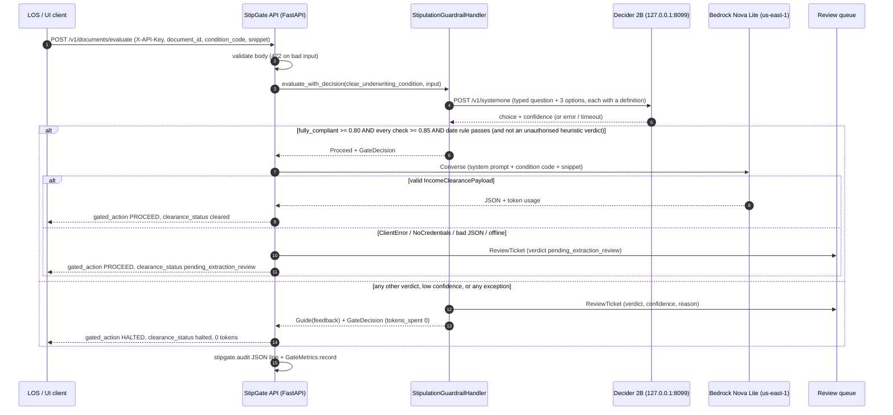

# StipGate architecture

StipGate gates the `clear_underwriting_condition` tool behind a local Strands Decider 2B verdict. Only
documents the gate passes reach Amazon Bedrock Nova Lite; everything else goes to a human loan officer
with zero LLM tokens spent. Every failure path fails closed.

Related docs: [DECIDER_HOSTING.md](DECIDER_HOSTING.md) (running the model), [DEPLOYMENT.md](DEPLOYMENT.md)
(edge / AWS topology), [USAGE.md](USAGE.md) (install, env vars, API, embedding).

## Components

| Component | Module | Role |
|---|---|---|
| Strands Agent | `stipgate.pipeline.build_agent` | Agent loop (Nova Lite via `BedrockModel`) with the clearance tool and the gate registered as an intervention. |
| `StipulationGuardrailHandler` | `stipgate/handlers.py` | `strands.interventions.InterventionHandler` subclass. Intercepts `before_tool_call` for `clear_underwriting_condition`. One Decider 2B request carries the document-type `choice` (three typed options) plus per-condition yes/no `noul` requirement checks; then a code date rule. Returns `Proceed` only if all pass, else `Guide`. `on_error="deny"`. |
| `DeciderClient` | `stipgate/decider_client.py` | stdlib `urllib.request` client. Modes: `server` (default, fails closed on outage), `heuristic` (offline simulator only), `auto` (server first, heuristic on outage, 30 s breaker). Heuristic verdicts never clear a condition unless `allow_heuristic_proceed=True`. Speaks `/decide` and the official `/v1/systemone` contract (404 retry). Bounded in-flight requests (`max_concurrency`, default 1). |
| Decider 2B sidecar | `strands-decider serve ...` | Local model server on loopback port 8099 (`POST /v1/systemone`, `GET /health`). Unauthenticated upstream; never exposed. See [DECIDER_HOSTING.md](DECIDER_HOSTING.md). |
| `BedrockExtractor` | `stipgate/bedrock_worker.py` | Nova Lite (`amazon.nova-lite-v1:0`, us-east-1) Converse extraction into the Pydantic v2 `IncomeClearancePayload`. On any AWS / parse failure it returns a regex/synthetic fallback marked `is_fallback`, which never clears. |
| Review queue | `HumanReviewQueue` protocol, `InMemoryReviewQueue` | Destination for `ReviewTicket`s (halted documents and `pending_extraction_review`). Back it with SQS / an LOS task API in production. The in-memory queue is per process and lost on restart. |
| `StipGatePipeline` | `stipgate/pipeline.py` | Batch / webhook path without an agent loop: gate, extract, return a trace dict. |
| Question builders | `stipgate/handlers.py` (`CONDITION_DOCUMENTS`, `build_question`, `build_criteria`) | Name the document each stipulation requires in the question and give every option a one-line definition (sent as the Decider `criteria`). |
| `DocumentTextExtractor` | `stipgate/ocr.py` | Turns an upload into gate text. File type from magic bytes. `.txt` decoded and text-layer PDFs read with `pypdf`, both locally; scanned PDFs and images transcribed by Nova Lite (Converse `document` / `image` block). 4 MB / 20 pages max, in memory only. |
| FastAPI service + UI | `stipgate/api.py`, `stipgate/static/index.html` | `GET /healthz`, `POST /v1/documents/evaluate`, `POST /v1/documents/upload`, `GET /v1/review-queue`, `GET /v1/samples`, `GET /v1/metrics`, `GET /` (self-contained test UI). Optional `X-API-Key` auth on `/v1/*`. |

## Request flow: `POST /v1/documents/evaluate`

`POST /v1/documents/upload` runs `DocumentTextExtractor` first (413 over 4 MB; 422 for unsupported, empty,
encrypted, over-20-page or textless files; 503 when OCR needs Bedrock and none is configured) and then
follows exactly this flow with the extracted text.



The same flow in ASCII:

```
LOS/UI ──POST /v1/documents/evaluate──► StipGate API ──422 on invalid body
                                            │
                                            ▼
                         StipulationGuardrailHandler.evaluate_with_decision
                                            │  typed question + 3 options
                                            ▼
                              Decider 2B @ 127.0.0.1:8099/v1/systemone
                                            │
            ┌───────────────────────────────┴──────────────────────────────┐
            │ fully_compliant >= 0.80, checks >= 0.85, date rule ok        │ anything else / error / timeout
            │ (heuristic only if allow_heuristic_proceed)                  │
            ▼                                                              ▼
   Nova Lite Converse (us-east-1)                                 Guide(feedback) ─► ReviewTicket
            │                                                     HALTED, clearance_status=halted, 0 tokens
   ┌────────┴─────────────────┐
   │ valid payload            │ ClientError / NoCredentials / bad JSON / offline
   ▼                          ▼
 PROCEED, cleared        PROCEED, pending_extraction_review ─► ReviewTicket
```

## Trust boundaries

```
 [Borrower / LOS / POS]                untrusted input (OCR text, document ids)
          │  HTTPS (TLS terminated at ALB / reverse proxy)
 ═════════╪══════════ boundary 1: X-API-Key (STIPGATE_API_KEY) on /v1/*, Pydantic validation
          ▼
 [StipGate API container]              edge host / ECS task
          │  http://127.0.0.1:8099 (loopback only)
 ═════════╪══════════ boundary 2: loopback; Decider has no auth, never published
          ▼
 [Decider 2B sidecar]                  same host / same task
          
 [StipGate API] ──HTTPS SigV4──► bedrock-runtime (us-east-1)
 ═════════════════════ boundary 3: IAM task role (bedrock:InvokeModel on Nova Lite only),
                                   VPC interface endpoint (PrivateLink) or egress proxy
```

- Boundary 1 is the only network-facing surface. Without `STIPGATE_API_KEY` the API is unauthenticated;
  `stipgate-serve` warns when bound to a non-loopback host without a key. `/healthz` and `/` stay open and
  return no document data.
- Boundary 2: the Decider server binds `127.0.0.1` by default and has no authentication
  ([inference.md](https://github.com/strands-labs/strands-decider/blob/main/docs/inference.md)). Keep it on
  loopback or a private task network.
- Boundary 3: least-privilege IAM and PrivateLink are described in [DEPLOYMENT.md](DEPLOYMENT.md).

## Data flow and PII

- OCR text stays at the edge for every document. The Decider runs on the same host.
- Only gated (PROCEED) documents leave the host: the Converse request holds the system prompt, the
  condition code and the snippet, sent to Bedrock in us-east-1 (region fixed in code).
- Exception: a scanned PDF or image sent to `POST /v1/documents/upload` goes to Nova Lite for OCR before
  the gate runs. `.txt` uploads and PDFs with a text layer are read locally. Uploaded bytes are never written
  to disk.
- Review tickets store a 240-character `snippet_preview` (may contain PII) plus verdict, confidence and
  reason. Treat the queue backend as a PII store.
- The `stipgate.audit` log line carries no snippet text and no extracted payload.
- API responses to the caller include the extracted payload (borrower and employer names, pay figures).
- The in-memory review queue and metrics live in process memory only.

## Fail-closed matrix

"Ticket" means a `ReviewTicket` is enqueued for a loan officer (when the queue accepts it).

| Condition | Outcome | Tokens spent | Ticket | Test |
|---|---|---|---|---|
| Decider unreachable or timeout, `server` mode (default) | `DeciderUnavailableError` -> `Guide`, HALTED, verdict `decider_error` | 0 | yes | `tests/test_stipgate.py::test_decider_default_server_mode_unreachable_raises`, `::test_server_unreachable_default_mode_handler_guides`, `::test_pipeline_fail_closed_trace` (TimeoutError), `::test_core_benchmark_without_opt_in_fails_closed`, `tests/test_api.py::test_default_server_mode_fails_closed_through_api` |
| Decider HTTP 5xx, `server` mode | `DeciderUnavailableError` -> `Guide` | 0 | yes | `tests/test_stipgate.py::test_decider_5xx_server_mode_raises`, `::test_decider_exception_fails_closed` |
| Decider HTTP 4xx (any mode) | `DeciderError` -> `Guide` (never heuristic) | 0 | yes | `tests/test_stipgate.py::test_decider_http_400_raises_decider_error`, `::test_handler_http_400_fails_closed` |
| `/decide` 404 then `/v1/systemone` 404 | `DeciderError` -> `Guide` | 0 | yes | `tests/test_stipgate.py::test_decider_404_on_systemone_retry_raises`, `::test_handler_404_on_systemone_retry_fails_closed` |
| Non-JSON response | `DeciderResponseError` -> `Guide` | 0 | yes | `tests/test_stipgate.py::test_decider_non_json_raises`, `::test_server_string_confidence_fails_closed` (same exception path in the handler) |
| Verdict outside the three options | `DeciderResponseError` / handler validation -> `Guide` | 0 | yes | `tests/test_stipgate.py::test_decider_invalid_server_verdict_raises`, `::test_out_of_options_verdict_fails_closed` |
| Confidence string (`"0.93"`), NaN, bool, null, outside [0, 1] | `DeciderResponseError` -> `Guide` | 0 | yes | `tests/test_stipgate.py::test_decider_invalid_confidence_raises`, `::test_server_string_confidence_fails_closed`, `::test_out_of_options_verdict_fails_closed` |
| Requirement check (yes/no `noul`) below `check_threshold` (default 0.85) | `Guide`, verdict `failed_requirement_check` | 0 | yes | `tests/test_stipgate.py::test_failed_requirement_check_halts`, `::test_requirement_checks_sent_in_same_request` |
| Requirement check missing from the server answer | `DeciderResponseError` -> `Guide`, verdict `decider_error` | 0 | yes | `tests/test_stipgate.py::test_missing_check_answer_fails_closed` |
| Decider approves but the paystub / statement is outside its window, future-dated or undated | `Guide`, verdict `failed_date_rule` (code, not the model) | 0 | yes | `tests/test_stipgate.py::test_stale_paystub_halted_by_date_rule_after_decider_approves`, `::test_unrelated_verdict_kept_when_date_missing` |
| `fully_compliant` below `confidence_threshold` (default 0.80; tests pin 0.88) | `Guide` (the threshold exactly proceeds) | 0 | yes | `tests/test_stipgate.py::test_threshold_087_returns_guide`, `::test_threshold_089_returns_proceed`, `::test_threshold_exactly_088_returns_proceed` |
| `invalid_unrelated_doc` / `ambiguous_requires_human_review` | `Guide` | 0 | yes | `tests/test_stipgate.py::test_non_compliant_verdict_high_confidence_guides`, `::test_utility_bill_returns_guide_via_heuristic`, `::test_corrupted_scan_returns_guide_via_heuristic` |
| Heuristic `fully_compliant` without `allow_heuristic_proceed` | `Guide`, reason "not authorised" | 0 | yes | `tests/test_stipgate.py::test_heuristic_compliant_without_opt_in_guides` |
| Heuristic with opt-in (CI / demo only) | `Proceed` (API sets `heuristic_warning: true`) | extraction tokens | only if extraction falls back | `tests/test_stipgate.py::test_heuristic_with_opt_in_proceeds`, `::test_core_benchmark_actions`, `tests/test_api.py::test_samples_evaluate_end_to_end` |
| `auto` mode outage (no opt-in) | heuristic answers, never clears; breaker skips the server for 30 s | 0 | yes | `tests/test_stipgate.py::test_auto_mode_outage_never_proceeds`, `::test_decider_unreachable_uses_heuristic`, `::test_decider_offline_circuit_breaker_skips_server` |
| Missing snippet, malformed condition code, non-mapping tool input | `Guide`, Decider not called | 0 | yes | `tests/test_stipgate.py::test_missing_snippet_fails_closed`, `::test_bad_condition_code_fails_closed`, `::test_before_tool_call_non_mapping_input_fails_closed` |
| Review queue down | Logged; call still HALTED (gate) or still `pending_extraction_review` (extraction) | 0 / extraction tokens | enqueue failed (logged) | `tests/test_stipgate.py::test_queue_failure_still_guides`, `::test_pipeline_extraction_review_enqueue_failure_still_pending` |
| Defect outside the handler's `try/except` | Strands `on_error="deny"` blocks the tool | 0 | no | `tests/test_stipgate.py::test_handler_on_error_is_deny_and_name` |
| Bedrock ClientError / NoCredentials / bad JSON / offline | Gate PROCEED, `clearance_status` `pending_extraction_review` (never `cleared`), synthetic fields listed | actual or estimated | yes | `tests/test_stipgate.py::test_extractor_client_error_falls_back`, `::test_extractor_no_credentials_falls_back`, `::test_extractor_malformed_json_falls_back_keeps_usage`, `::test_extractor_offline_fallback_marks_synthetic_fields`, `::test_pipeline_proceed_trace_has_payload`, `::test_agent_direct_tool_call_proceeds` |
| API validation error (unknown code, snippet > 50,000 chars, empty, bad id, extra field) | HTTP 422, nothing evaluated | 0 | no | `tests/test_api.py::test_evaluate_validation_errors` |
| Missing / wrong `X-API-Key` when auth enabled | HTTP 401 | 0 | no | `tests/test_api.py::test_api_key_required_on_v1_routes`, `::test_api_key_from_env` |
| Unexpected exception in the API handler | HTTP 500 `internal error; document not cleared` | none reported | not guaranteed: caller must retry or route manually | `tests/test_api.py::test_pipeline_exception_returns_generic_500` |
| Non-target tool | `Proceed`, Decider not called (not gated) | n/a | no | `tests/test_stipgate.py::test_non_target_tool_bypasses_decider` |

## Observability

Audit log (implemented). Logger `stipgate.audit` emits one compact JSON line per evaluation:

```json
{"event": "stipgate.evaluate", "document_id": "SG-001", "condition_code": "STIP_INCOME_30DAY",
 "gated_action": "PROCEED", "clearance_status": "pending_extraction_review", "verdict": "fully_compliant",
 "confidence": 0.96, "decider_backend": "heuristic", "decider_latency_ms": 0.85, "latency_ms": 0.9,
 "tokens_spent": 323, "review_ticket_ids": ["<ticket id>"]}
```

No snippet text and no payload (tested by `tests/test_api.py::test_audit_log_has_no_snippet_or_payload`).

Metrics endpoint (implemented). `GET /v1/metrics` returns in-process counters since start: `requests`,
`proceeded`, `halted`, `cleared`, `pending_extraction_review`, `tokens_spent`, `by_backend`
(`server` / `heuristic` / `none`), and `gate_latency_ms` (`samples`, `p50`, `p95` over the last 1000
evaluations). Counters are per process.

Uploads add an `ocr` object to the audit line (method, pages, chars, token counts; never the text), and
`/v1/metrics` adds `uploads`, `ocr_tokens_spent` and `by_ocr_method`.

CloudWatch (guidance only; the `deploy/aws` scripts do not ship logs to CloudWatch). Ship container stdout with the
`awslogs` driver and add metric filters on the audit line, for example:

| Metric | Filter pattern | Value |
|---|---|---|
| Gate latency | `{ $.event = "stipgate.evaluate" }` | `$.decider_latency_ms` |
| Halts | `{ $.event = "stipgate.evaluate" && $.gated_action = "HALTED" }` | `1` |
| Decider outages | `{ $.event = "stipgate.evaluate" && $.verdict = "decider_error" }` | `1` |
| Heuristic verdicts in production | `{ $.event = "stipgate.evaluate" && $.decider_backend = "heuristic" }` | `1` |
| Tokens spent | `{ $.event = "stipgate.evaluate" }` | `$.tokens_spent` |
| Extraction reviews | `{ $.event = "stipgate.evaluate" && $.clearance_status = "pending_extraction_review" }` | `1` |

`stipgate-serve` configures `logging.basicConfig` with a `%(asctime)s %(levelname)s %(name)s %(message)s`
format, so each audit event is prefixed and is not pure JSON. JSON metric filters need the whole event to
be JSON: attach a handler with a bare `%(message)s` formatter to the `stipgate.audit` logger in your
deployment wrapper (not shipped in this repo), or use term-based filter patterns. Alarm on any heuristic
verdict in production and on a sustained `decider_error` rate (the Decider is down and every document is
going to humans).
